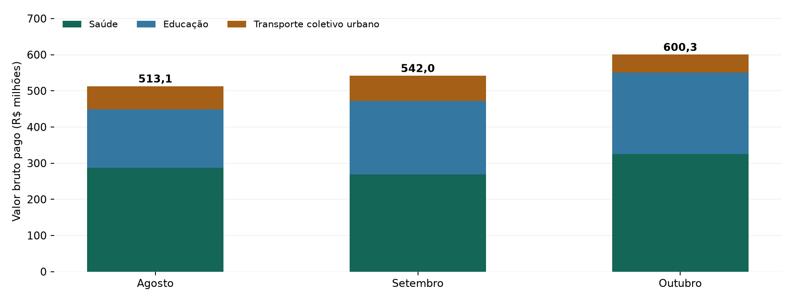

# Para onde vai o dinheiro de Curitiba?

Projeto de Análise de Dados Governamentais Abertos sobre os pagamentos de saúde, educação e transporte coletivo urbano do Município de Curitiba, de agosto a outubro de 2026.

O projeto reúne a definição do escopo, o pipeline ETL, o painel interativo e o relatório técnico final.

## Ver o trabalho

- Baixe o repositório em **Code → Download ZIP**, extraia e abra [index.html](index.html) no Edge, Chrome ou Firefox.
- Use os filtros de área e mês ou clique nas barras para explorar o gráfico mensal, os grupos de despesa e as cinco ações com maior valor pago.
- Leia o [relatório técnico em PDF](relatorio_tecnico.pdf) ou a [versão em texto](relatorio_tecnico.md).
- Consulte o [CSV tratado](dados/tratados/pagamentos_tratados.csv) e a [auditoria do tratamento](dados/tratados/auditoria_etapa2.json).

O painel contém seus próprios dados e funciona offline. Os links de arquivos HTML no GitHub abrem o código. Para usar os controles, abra o arquivo baixado no navegador.

## Perguntas da análise

1. Qual das três áreas concentra o maior valor pago?
2. Como os pagamentos variam entre agosto, setembro e outubro?
3. Quais grupos e ações orçamentárias concentram os valores de cada área?

## Fonte e delimitação

A Secretaria Municipal de Finanças disponibiliza o conjunto **Base de receitas e despesas** com atualização mensal. A análise usa o CSV de despesas da edição de **01/11/2026**, com transações de agosto a outubro de 2026. Os fundos municipais integram o recorte.

- [Catálogo oficial](https://dadosabertos.curitiba.pr.gov.br/conjuntodado/detalhe?chave=5DDFFBE8-313B-4D94-A862-73AB74B3817C)
- [CSV original de despesas](https://mid-dadosabertos.curitiba.pr.gov.br/BaseReceitaDespesa/2026-11-01_Despesas_-_Base_de_Dados.csv)
- [Dicionário de dados](https://mid-dadosabertos.curitiba.pr.gov.br/BaseReceitaDespesa/2025-06-18_Despesas_-_Dicionario_de_Dados.xlsx)

| Área | Classificação selecionada |
|---|---|
| Saúde | Função 10 |
| Educação | Função 12 |
| Transporte coletivo urbano | Função 15, Urbanismo, e subfunção 453 |

O transporte coletivo está registrado na subfunção 453 nesta edição. A saúde inclui o Fundo Municipal da Saúde, e o transporte inclui o Fundo de Urbanização de Curitiba.

## Reprodução do ETL e do painel

Requer **Python 3.10 ou superior**. Os scripts de tratamento e geração do painel usam a biblioteca padrão do Python.

Na pasta extraída ou clonada, execute:

```powershell
python executar.py
```

O comando baixa a edição original, verifica o SHA-256, gera os arquivos de tratamento e reconstrói o painel. O primeiro download tem aproximadamente 59 MB. O arquivo bruto fica em `dados/brutos/`. O hash esperado é `6a3eb604c6184e533891197d3e71a39658db7eef766b029e20bd1f69c39e1982`.

Para utilizar o CSV original já disponível no computador:

```powershell
python executar.py --csv "C:/caminho/2026-11-01_Despesas_-_Base_de_Dados.csv"
```

Para reconstruir apenas o painel usando os dados tratados incluídos:

```powershell
python src/gerar_painel_curitiba.py dados/tratados/pagamentos_tratados.csv dados/tratados/auditoria_etapa2.json index.html
```

## Regras de tratamento

O pipeline lê UTF-8 com BOM e separador ponto e vírgula, valida o cabeçalho, filtra as áreas e remove duplicatas exatas comparando as colunas originais. Mantém eventos do tipo `Pagamento de Empenho` com data no período e valor válido e diferente de zero.

Datas são convertidas para ISO, valores para `Decimal` com duas casas e identificadores para texto. Descrições vazias recebem “Não informado”. A data de referência é `DT_TRANSACAO`, e o indicador é `VL_PAGO`. O CSV tratado usa vírgula como delimitador e ponto decimal.

| Resultado do processamento | Linhas |
|---|---:|
| Entrada | 87.868 |
| Fora das áreas | 64.682 |
| Duplicatas exatas no recorte | 33 |
| Sem tipo de transação após deduplicação | 9.186 |
| Outros tipos de transação | 7.197 |
| Data, valor ou período inválidos entre pagamentos | 0 |
| Pagamentos exportados | 6.770 |

As duplicatas removidas eram registros sem tipo de transação. Os pagamentos exportados ficaram sem campos vazios. A auditoria registra as contagens, o hash da origem e os totais por mês e área.

## Resultados e limites

| Área | Pagamentos | Valor bruto pago |
|---|---:|---:|
| Saúde | 3.663 | R$ 881.800.192,91 |
| Educação | 2.769 | R$ 589.523.676,23 |
| Transporte coletivo urbano | 338 | R$ 184.098.927,46 |
| Total das três áreas | 6.770 | R$ 1.655.422.796,60 |



A interpretação considera pagamentos brutos em reais correntes e o recorte da edição selecionada. Devoluções são operações próprias e ficam fora da soma de pagamentos. Saúde e Educação abrangem funções inteiras, enquanto transporte coletivo corresponde à subfunção 453. Os resultados descrevem a execução financeira dessas classificações. O relatório discute os limites de comparação, a defasagem entre empenho e pagamento e o período de três meses.

## Regerar gráficos e relatório

Esta etapa opcional usa Matplotlib e ReportLab:

```powershell
python -m pip install -r requirements-relatorio.txt
python gerar_relatorio.py
```

O comando recria as figuras e as versões Markdown e PDF do relatório a partir do CSV tratado.
