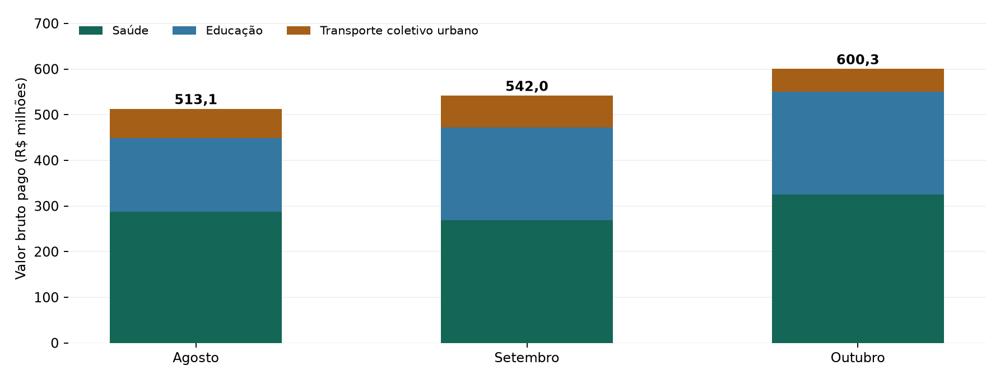
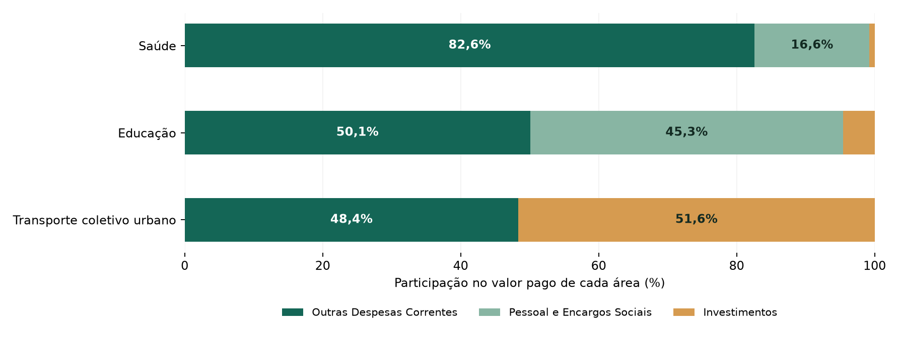

# Para onde vai o dinheiro de Curitiba?

## Relatório técnico final

Análise de Dados Governamentais Abertos - 2º Bimestre

Período de agosto a outubro de 2026. Relatório de 24/11/2026.

Projeto no GitHub: [https://github.com/Mathelico/gastos-publicos-curitiba](https://github.com/Mathelico/gastos-publicos-curitiba)

## 1. Introdução

Este projeto examina a distribuição dos pagamentos municipais de Curitiba em saúde, educação e transporte coletivo urbano, entre agosto e outubro de 2026. A comparação procura tornar os registros de execução financeira mais acessíveis e relacioná-los a serviços presentes no cotidiano da população.

As perguntas orientadoras são identificar a área com maior valor pago, acompanhar a evolução mensal e reconhecer os grupos e ações orçamentárias de maior participação. A hipótese descritiva de concentração dos pagamentos em saúde e educação é examinada pelos totais e pela composição observada.

## 2. Metodologia

A análise utiliza a edição de 01/11/2026 da Base de receitas e despesas da Secretaria Municipal de Finanças. O catálogo informa atualização mensal e cobertura de três meses. A unidade de análise é cada evento classificado como Pagamento de Empenho, com DT_TRANSACAO no período e VL_PAGO válido e diferente de zero. O processamento seleciona Saúde (função 10), Educação (função 12) e Transportes Coletivos Urbanos (função 15, Urbanismo, e subfunção 453). Inclui os fundos municipais.

O CSV original foi lido como UTF-8 com BOM, com separador ponto e vírgula. As duplicatas exatas foram identificadas comparando todas as colunas de origem. Datas e valores obrigatórios foram validados. Descrições opcionais vazias recebem Não informado. Nesta edição, todos os pagamentos exportados tinham esses campos preenchidos. O mês foi derivado da data da transação. Valores foram calculados com Decimal e centavos inteiros, e identificadores foram mantidos como texto. A auditoria registra o SHA-256 da fonte e os totais por mês e área.

Python e sua biblioteca padrão foram escolhidos para o ETL, a auditoria e a geração do painel por permitirem execução reproduzível com aritmética decimal. HTML, CSS e JavaScript permitem consultar o painel offline, filtrar área e mês e explorar as ações. Matplotlib gera as figuras estáticas, e ReportLab compõe este relatório.

| Resultado do ETL | Linhas |
| --- | --- |
| Entrada | 87.868 |
| Fora das áreas | 64.682 |
| Duplicatas exatas no recorte | 33 |
| Sem tipo de transação após deduplicação | 9.186 |
| Outros tipos de transação | 7.197 |
| Pagamentos descartados por data, valor ou período | 0 |
| Pagamentos exportados | 6.770 |

## 3. Análise visual

### Distribuição e evolução mensal

| Área | Pagamentos | Valor bruto pago |
| --- | --- | --- |
| Saúde | 3.663 | R$ 881.800.192,91 |
| Educação | 2.769 | R$ 589.523.676,23 |
| Transporte coletivo urbano | 338 | R$ 184.098.927,46 |
| Total | 6.770 | R$ 1.655.422.796,60 |

| Mês | Saúde | Educação | Transporte coletivo urbano |
| --- | --- | --- | --- |
| Agosto | R$ 287.108.884,34 | R$ 161.306.419,92 | R$ 64.662.341,53 |
| Setembro | R$ 268.958.369,63 | R$ 203.430.644,00 | R$ 69.612.020,36 |
| Outubro | R$ 325.732.938,94 | R$ 224.786.612,31 | R$ 49.824.565,57 |

A saúde liderou os pagamentos nos três meses e reuniu 53,3% do total. A educação representou 35,6%, e o transporte coletivo, 11,1%. O total mensal passou de R$ 513.077.645,79 em agosto para R$ 600.344.116,82 em outubro, variação nominal de 17,0%. A educação aumentou em cada mês. Saúde e transporte apresentaram trajetórias diferentes, com queda da saúde em setembro e maior valor do transporte nesse mesmo mês.

### Composição e ações de maior valor

Outras Despesas Correntes somaram R$ 1.112.826.466,62, equivalentes a 67,2% dos pagamentos. Pessoal e Encargos Sociais representaram 25,0%, e Investimentos, 7,8%. No transporte coletivo, os investimentos foram 51,6% dos valores pagos. A educação apresentou maior participação de pessoal que as outras áreas.

| Área | Ação orçamentária | Valor pago |
| --- | --- | --- |
| Saúde | MANUTENÇÃO E IMPLEMENTAÇÃO DOS PROGRAMAS DE SAÚDE DISPONIBILIZADOS À POPULAÇÃO | R$ 649.331.312,50 |
| Saúde | ATENDIMENTO DE DESPESA COM A FOLHA DE PAGAMENTO DOS SERVIDORES MUNICIPAIS DE CURITIBA - FMS | R$ 153.708.056,72 |
| Educação | MANUTENÇÃO DA EDUCAÇÃO BÁSICA, POR MEIO DA POLÍTICA MUNICIPAL DE ENSINO | R$ 152.639.037,11 |

As ações são agrupadas pela área e pela descrição orçamentária, somando os pagamentos no período.

## 4. Limitações

Os indicadores representam pagamentos brutos em reais correntes, antes da dedução das devoluções. Consignações, anulações e liquidações têm eventos próprios, excluídos do indicador. O recorte compara duas funções amplas com uma subfunção de transporte e abrange os registros disponibilizados na edição escolhida. O prazo entre empenho, liquidação e pagamento pode deslocar despesas entre meses e exercícios. A amostra temporal cobre três meses e conserva a situação da publicação de 01/11/2026, sujeita a revisões posteriores. A comparação descreve o fluxo financeiro observado. Avaliar qualidade ou eficiência dos serviços exige indicadores de atendimento, custos unitários e contexto orçamentário adicionais.

## 5. Conclusões

Os resultados sustentam a hipótese descritiva de concentração em saúde e educação, que juntas corresponderam a 88,9% do valor analisado. A composição dos pagamentos expõe diferenças entre as áreas, especialmente o peso dos investimentos no transporte coletivo. A rastreabilidade entre CSV, auditoria, gráficos e painel permite conferir essas observações e reutilizar o procedimento com o recorte explicitado.

## 6. Reprodução

O README descreve os comandos. Execute `python executar.py` para baixar a edição original, conferir seu SHA-256, tratar os dados e gerar `index.html`. Use `--csv` com o arquivo de origem para execução offline. O painel e a auditoria também estão incluídos no repositório.

## 7. Referências

Prefeitura Municipal de Curitiba. Secretaria Municipal de Finanças. [Base de receitas e despesas](https://dadosabertos.curitiba.pr.gov.br/conjuntodado/detalhe?chave=5DDFFBE8-313B-4D94-A862-73AB74B3817C). Metadados consultados na preparação da Etapa 2, em 10/11/2026.

[CSV original, edição de 01/11/2026](https://mid-dadosabertos.curitiba.pr.gov.br/BaseReceitaDespesa/2026-11-01_Despesas_-_Base_de_Dados.csv). SHA-256 `6a3eb604c6184e533891197d3e71a39658db7eef766b029e20bd1f69c39e1982`.

[Dicionário de dados, edição de 18/06/2025](https://mid-dadosabertos.curitiba.pr.gov.br/BaseReceitaDespesa/2025-06-18_Despesas_-_Dicionario_de_Dados.xlsx).
